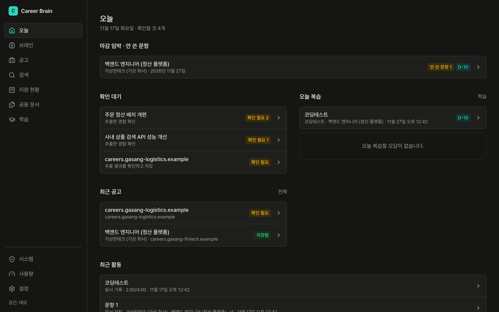
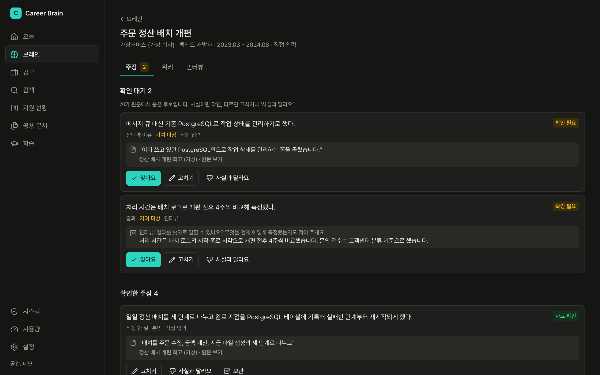
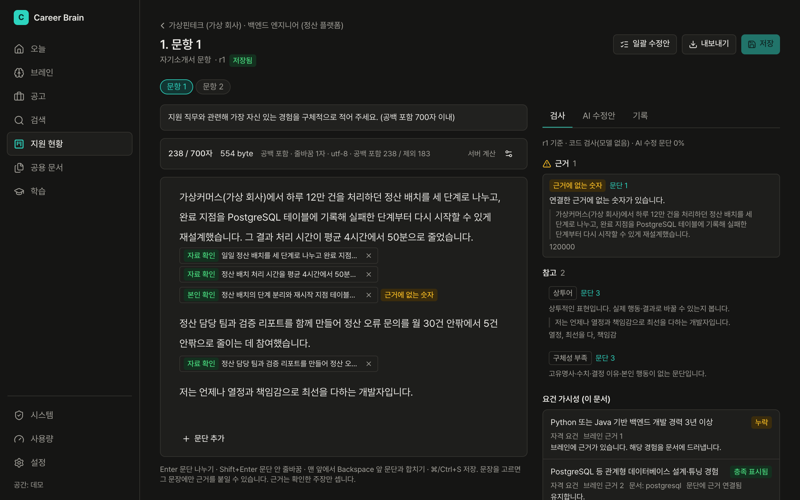

# career-brain

개인 서버에서 경력·프로젝트·학습·문서·관심 공고·지원 이력을 관리하는 **개인용 커리어 브레인** 오픈소스.
이력서와 자료를 올리면 원문 위치까지 근거로 남기고, 사람이 확인한 사실만으로 지원 문서를 쓰고 검사한다.

[English](#english) · [설치](#설치) · [구조](docs/architecture/overview.md) · [기여](CONTRIBUTING.md) · [보안](SECURITY.md)

> 상태: v0.1 — 1차 범위 구현 완료. 문서·화면은 한국어. 한 사람이 쓰는 개인 설치용이다.



| 경험: 원문 인용이 달린 주장, 사람이 확인 | 지원 문서: 근거 연결과 코드 검사 |
|---|---|
|  |  |

## 무엇을 하나

| 영역 | 하는 일 |
|---|---|
| 브레인 | 이력서·문서(텍스트·HTML·PDF·DOCX·PPTX·XLSX·HWPX)를 올리면 파싱해 원문 위치까지 남긴다. 경험·주장(claim)은 원문 인용 근거와 함께 저장되고, 사람이 확인해야 사실이 된다. 인터뷰형 질문으로 경험을 정리한다. |
| 검색 | 키워드(pg_trgm) + 선택 의미 검색(OpenAI 또는 로컬 임베딩)을 RRF로 합친다. 기술명 별칭(쿠버네티스 ↔ Kubernetes)도 찾는다. 공간 밖 결과 0건. |
| 공고 | 붙여넣은 URL만 가져온다 (내부 주소 차단, 쿠키 없음). 구조화 데이터 → 채용 시스템 어댑터 → 인용 검증 LLM 순으로 추출. 무변경 재수집은 버전을 만들지 않는다. |
| 지원·문서 | 문항별 문서, 근거 연결, 코드가 센 글자·바이트 수, 범용 문장·다른 회사 문장·근거 없는 서술·요건 가시성·숨김 글 검사, 사실을 바꾸지 못하는 AI 수정안, 불변 제출본. |
| 학습 | 공고 요건 → 학습 항목·시험 → 시도·오답 → 복습 일정. 학습은 경력으로 바뀌지 않는다. |
| 실행·승인·MCP | 재시작 후 재개되는 작업, 사람만 하는 승인(대상이 바뀌면 무효), AI 클라이언트용 MCP 도구 (웹과 같은 권한 검사). [mcp.md](docs/architecture/mcp.md) · 스킬: [skills/](skills/) |
| 운영 | 한 프로세스 실행(유휴 약 100MB), 공간 내보내기·복원(개수·해시 검증, 암호화 선택), 모델 호출 장부·월 예산. |

모델 API 키가 없어도 업로드·파싱·키워드 검색·문서 검사·학습·지원 관리는 동작한다. 경험 추출·인터뷰 질문·수정안·의미 검색에는 모델 설정(`models.toml`)이 필요하다.

## 설치

자세한 설명·백업·업데이트·리버스 프록시: [docs/operations/install.md](docs/operations/install.md) · 내보내기·복원: [docs/operations/backup.md](docs/operations/backup.md)

**Docker (서버)** — 앱 1개(API + worker + 웹) + PostgreSQL/pgvector.

```bash
git clone https://github.com/gkrtjd99/career-brain.git && cd career-brain/deploy/docker
cp .env.example .env && cp app.env.example app.env      # DB 비밀번호(openssl rand -hex 24), 모델 키
mkdir -p config && cp ../../models.example.toml config/models.toml   # 선택
docker compose up -d --build                             # db → migrate → app (127.0.0.1:8000)
docker compose run --rm app bootstrap                    # 첫 설치 때 한 번: 내 공간 + API 토큰
docker compose run --rm app demo                         # 선택: 예시 데이터 공간 + 토큰 (둘러보기용)
```

http://127.0.0.1:8000 을 열고 설정 화면에 토큰을 넣는다. 인터넷에 열 때는 앞에 TLS 리버스 프록시(Caddy 등)를 둔다. DB 포트는 열리지 않고 앱은 기본 localhost에만 열린다.

**로컬 (uv)**

```bash
uv sync --package personal-api --no-dev                  # 로컬 임베딩까지: --extra local-embed
docker compose -f deploy/compose/compose.yaml up -d db   # 개발용 DB (127.0.0.1)
uv run --no-sync personal-api migrate
uv run --no-sync personal-api bootstrap                  # 또는 demo
npm ci && npm run build                                  # 웹 화면
uv run --no-sync personal-api serve                      # http://127.0.0.1:8000
```

**업데이트**: `git pull` → (Docker) `docker compose up -d --build` / (로컬) `uv sync ... && personal-api migrate`. 그 전에 `pg_dump` 백업 또는 `personal-api export` ([backup.md](docs/operations/backup.md)).

**모델 연결**: `models.example.toml`을 `models.toml`로 복사하고 키는 환경변수로 둔다. `personal-api models`(상태, 키 값은 출력 안 함) · `pricing`(단가표) · `ping`(연결 확인, 종량제면 과금) · `usage`(사용량). 검색 임베딩 기본은 OpenAI `text-embedding-3-large` 1024차원, 더 싸게는 `3-small` 512차원, 자료를 밖으로 보내지 않으려면 로컬 모델. 비교: [search.md](docs/architecture/search.md) · 게이트웨이: [models.md](docs/architecture/models.md)

**AI 클라이언트 연결** (Claude Code·Desktop 등): 같은 API 토큰으로 MCP `http://127.0.0.1:8000/api/core/mcp` 또는 `personal-api mcp`(stdio). 업무 도구만 있고 승인은 사람만 한다. [mcp.md](docs/architecture/mcp.md)

## 구조

```text
apps/personal-web     React + TS + Vite (개인 대시보드)
apps/personal-api     FastAPI 조립, CLI, 한 프로세스 실행
packages/core         career_core: domain / usecases / interfaces / jobs / workflows / llm / adapters / db / migrations
packages/ui           공통 UI 조각
packages/client       TS API 클라이언트
contracts/            OpenAPI·JSON Schema·호환성
skills/               업무 스킬 (SKILL.md)
deploy/               개발용 DB compose, 서버 배포 compose (Dockerfile은 레포 루트)
```

한 장 요약(다이어그램 포함): [docs/architecture/overview.md](docs/architecture/overview.md) · DB·RLS: [database.md](docs/architecture/database.md) · 실행·승인: [runs.md](docs/architecture/runs.md) · 웹 화면: [web.md](docs/architecture/web.md) · 설계 기록과 백로그: [plan.md](docs/architecture/plan.md)

## 개발

```bash
uv sync && npm install
docker compose -f deploy/compose/compose.yaml up -d db
uv run pytest                                  # DB 테스트는 임시 DB를 만들고 지운다
uv run ruff format . && uv run ruff check .
npm run typecheck && npm run build
uv run uvicorn personal_api.main:app --reload  # API만 (http://127.0.0.1:8000)
uv run personal-api worker                     # 백그라운드 작업
npm run dev                                    # 웹 (http://localhost:5173, /api는 8000으로 프록시)
```

규칙과 확인 절차: [CONTRIBUTING.md](CONTRIBUTING.md)

## 원칙

- 모델 출력은 사실이 아니다. AI가 만든 경험·주장은 사람이 확인해야 확정되고, 수정안은 사실을 바꾸지 못한다.
- 공간마다 DB 수준에서 격리한다 (FORCE RLS). 바깥 기능은 작은 포트로만 받고, 주입이 없으면 거부가 기본이다.
- 실제 개인정보·키·쿠키·DB 덤프를 커밋하지 않는다. 데모·테스트는 합성 데이터만.
- `packages/core`에 결제·플랜·서비스 운영 코드를 넣지 않는다.

## English

A self-hosted career "second brain" for one person. Upload your resume and documents (text, HTML, PDF, DOCX, PPTX, XLSX, HWPX); career-brain parses them, keeps the exact source location of every quote, and lets you build **experiences and claims backed by evidence** — nothing an AI extracts counts as fact until you confirm it.

On top of that: hybrid keyword + semantic search, job postings saved from URLs you paste (structured data → ATS adapters → citation-checked LLM extraction), per-question application documents with deterministic checks (character/byte counts, generic or copied-from-another-company sentences, unsupported statements, requirement visibility, hidden text), AI suggestions that cannot change facts, study tracking for posting requirements, resumable runs with human-only approvals, and an MCP server so AI clients (Claude Code, Claude Desktop, …) can work with the same permissions as the web UI.

- **Runs as one process** (API + worker + web, ~100 MB idle) plus PostgreSQL with pgvector. Docker compose included.
- **Works without any model key** for upload, parsing, keyword search, document checks, study and application tracking. Extraction, interview questions, suggestions and semantic search need a model route in `models.toml` (Anthropic, OpenAI, Gemini, xAI, OpenAI-compatible, Ollama or local embeddings), with a monthly budget and a call ledger.
- **Isolation in the database**: every user table has `workspace_id` with forced row-level security.
- **Try it**: follow the Docker steps above, then `docker compose run --rm app demo` prints a token for a workspace filled with synthetic sample data.

The UI and docs are Korean. Architecture overview (diagram): [docs/architecture/overview.md](docs/architecture/overview.md). Issues and PRs in English are welcome — see [CONTRIBUTING.md](CONTRIBUTING.md) and [SECURITY.md](SECURITY.md).

## License

[Apache-2.0](LICENSE). Third-party licenses: [docs/architecture/third-party-licenses.md](docs/architecture/third-party-licenses.md)
