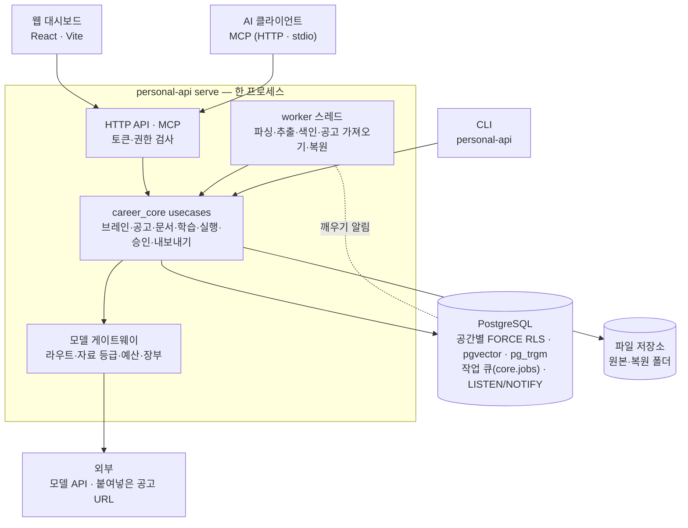

# 구조 한눈에 보기

지금 구현된 구조의 요약이다. 설계 배경과 결정 이유는 [plan.md](plan.md), 영역별 규칙은 아래 표의 문서에 있다.

## 실행 구조



- **한 프로세스**: `personal-api serve`가 API, worker(별도 스레드), 빌드한 웹 정적 파일을 함께 맡는다. 앱 유휴 메모리 약 100MB. API와 worker를 따로 띄울 수도 있다 (`personal-api worker`).
- **작업 큐는 PostgreSQL 표**다 (`core.jobs`). `core.claim_job`이 다음 작업을 잠그고 lease 값을 준다. 결과를 저장할 때 그 lease인지 확인해, 늦게 끝난 worker가 새 결과를 덮어쓰지 못한다. 새 작업이 생기면 trigger가 `NOTIFY`로 쉬는 worker를 깨운다 (힌트일 뿐, 놓쳐도 주기 확인으로 집는다). 별도 큐 서버(Redis 등)는 없다.
- **공간 격리**: 모든 사용자 표에 `workspace_id`가 있고 FORCE RLS가 걸린다. 요청마다 `app.workspace_id`를 정한 세션으로만 읽고 쓴다. 공간을 넘나드는 일(작업 집기 등)은 `search_path`를 고정한 SECURITY DEFINER 함수 몇 개로 한정한다. [database.md](database.md)
- **모델 호출은 게이트웨이 하나로**: 용도별 라우트(`models.toml`), 자료 등급별 허용 엔드포인트, 월 예산, 단가표, 호출 장부. 라우트가 없거나 키가 없으면 호출하지 않는다. 키 없이도 업로드·파싱·키워드 검색·문서 검사·학습은 돈다. [models.md](models.md)
- **외부 연결은 작은 포트로**: `career_core.ports`(모델, 임베딩, 파일, 파서, 권한, egress, 예산, 알림, 감사). 주입하지 않으면 거부가 기본이다.

## 코드 배치

```text
apps/personal-api     FastAPI 조립(composition root), CLI, 한 프로세스 실행
apps/personal-web     React 대시보드 (TanStack Router · Query, Tailwind)
packages/core         career_core
  domain/               규칙·상태 (DB 모름): 문서 검사, 숨김 글, 한국어, 공고, 학습
  usecases/             읽기·쓰기·확정의 공통 처리 (HTTP·MCP·CLI·worker가 같이 쓴다)
  interfaces/http|mcp/  라우터와 MCP 도구 — 요청 검증과 usecase 호출만
  jobs/                 worker, lease, 깨우기, 주기 유지보수
  workflows/            여러 단계 실행(일괄 수정안·인터뷰 질문), 재시작 후 이어감
  llm/                  모델 게이트웨이, 단가표, 제공자 설정
  adapters/             파서(텍스트·HTML·PDF·DOCX·PPTX·XLSX·HWPX), 웹 가져오기, 채용 시스템, 임베딩, 암호화
  db/ · migrations/     SQLAlchemy 모델, Alembic (core c00NN, personal p00NN)
  evals/                합성 평가 세트 (검색·임베딩·판정·한국어)
packages/client       TS API 클라이언트
packages/ui           공통 UI 조각
skills/               AI 클라이언트용 업무 스킬
deploy/               개발용 DB compose, 서버 배포 compose
```

## 영역별 문서

| 영역 | 문서 |
|---|---|
| DB·역할·RLS·migration 기록 | [database.md](database.md) |
| 원본·경험·주장·지원·문서 검사 | [applications.md](applications.md) |
| 공고 가져오기·추출 | [postings.md](postings.md) |
| 검색·임베딩·별칭 | [search.md](search.md) |
| 학습 | [study.md](study.md) |
| 실행·승인·worker | [runs.md](runs.md) |
| MCP·OAuth | [mcp.md](mcp.md) |
| 모델 게이트웨이·비용 | [models.md](models.md) |
| 웹 화면 | [web.md](web.md) |
| 설치·운영 | [../operations/install.md](../operations/install.md) |
| 내보내기·복원 | [../operations/backup.md](../operations/backup.md) |
| 언어 선택 (Rust 검토) | [rust.md](rust.md) |
